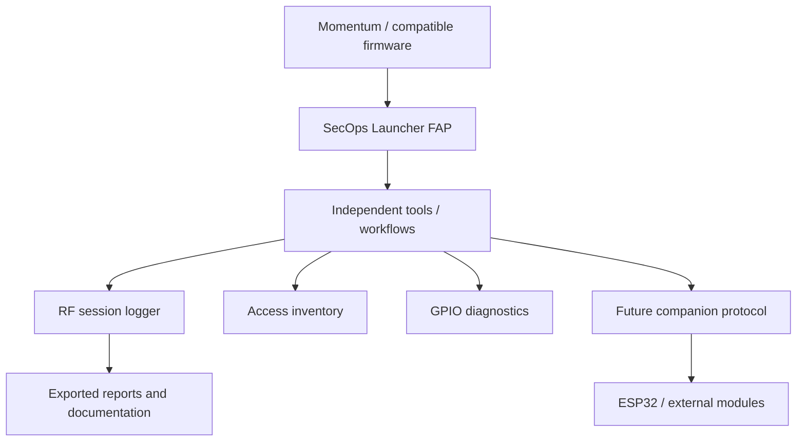

# Architecture

Flipper SecOps X is an application suite, not a replacement firmware.

## Design decisions
- Standalone FAP first; fork only for proven API or driver requirements.
- Design for 128x64 monochrome display and five-way navigation.
- Maintain separate `docs/decisions/` records for major decisions.
- Verify licenses and firmware compatibility before integrating external apps.
